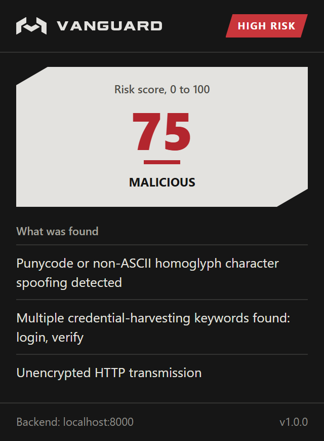
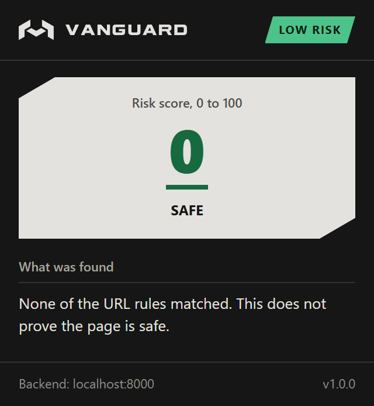

# Vanguard


Vanguard is a Manifest V3 Chrome extension with a small FastAPI service behind it. The service scores a web address against ten fixed rules and returns a score, a verdict and the rules that matched. It runs on your own machine.

The repository is still named `PhishGuard`, the project's earlier name.

A static project page is in [docs/index.html](docs/index.html). Open it from a clone of the repository.

## What it does

1. After a page loads, `content.js` sends that page's address to the service worker, which posts it to `http://localhost:8000/scan`. Only `http` and `https` addresses are sent. The `#` fragment is removed first, and a username or password in the address is replaced by the word `redacted`.
2. If the verdict is `MALICIOUS`, a dismissible warning bar appears at the top of the page.
3. The toolbar popup scans the active tab each time you open it and shows the score and the matched rules.
4. If a page can't be checked (the service doesn't answer within 5 seconds, it returns an error, or the address isn't a web address), the verdict is `UNKNOWN`. The toolbar icon shows `?`, no bar is drawn, and the popup says the page was not checked.

It looks only at the address. It does not read page content or links, block navigation, cache results or use a blocklist.

## The popup

| High risk | No rule matched | Service not running |
|---|---|---|
|  |  |  |

These are headless Chrome renders of the shipped popup files. The `chrome.tabs` lookup was stubbed to supply a sample address, and the scores came from a locally running backend.

## Scoring rules

Points add up and are capped at 100. Source: [backend/detector.py](backend/detector.py).

| Rule | Matches when | Points |
|---|---|---|
| Lookalike characters | After punycode is decoded, a hostname label mixes writing systems (Latin with Chinese, Japanese or Korean is allowed), is written wholly in Cyrillic or Greek letters that look Latin, or imitates a listed brand with lookalike or accented letters. Punycode that doesn't decode also matches | 45 |
| Internationalised name | Any other hostname with a punycode label (`xn--`) or a non-ASCII character. Not added on top of the rule above | 15 |
| Brand name | The hostname contains paypal, apple, google, microsoft, amazon, netflix, chase, wellsfargo, bankofamerica, binance or coinbase, and its registrable domain is not exactly that name on an accepted ending: `.com`, a listed `co.` or `com.` country ending such as `.co.uk` or `.com.au`, or `.de` `.fr` `.it` `.es` `.nl` `.ca` `.in` `.ie` `.at` `.be` `.ch` `.se` `.pl` | 40 |
| IP address | The host is a bare IPv4 address | 35 |
| At sign | `@` appears anywhere in the address | 30 |
| Risky ending | The hostname ends in `.xyz` `.top` `.buzz` `.club` `.work` `.cfd` `.sbs` or `.cam` | 20 |
| Sign-in words | The path or query contains at least two of: login, signin, verify, secure, update, banking, account, password, credential, auth, wallet, recover | 20 |
| Random-looking host | Shannon entropy of the hostname is above 4.2 | 20 |
| Deep subdomains | Three or more labels sit in front of the registrable domain (`example.com`, `example.co.uk`) | 15 |
| No HTTPS | The scheme is not `https` (an address without a scheme is treated as `http`) | 10 |

| Score | Verdict |
|---|---|
| 0 to 24 | `SAFE` |
| 25 to 59 | `SUSPICIOUS` |
| 60 to 100 | `MALICIOUS` |

`SAFE` means few or no rules matched. It does not mean the site is trustworthy.

## Known limits

- A phishing page on an ordinary-looking or hijacked domain scores low.
- The brand check matches text inside names, so `pineapple.com` (apple) and `purchase.com` (chase) are flagged. So are other domains the brands own, such as `googleapis.com` or `microsoftonline.com`. Misspellings such as `paypa1.com` are not caught.
- A brand name on an accepted ending is trusted without checking who owns it. The list of two-part endings is a short built-in one, not the full Public Suffix List.
- The lookalike check uses a short hand-picked table of letters. Other lookalikes get only the 15 internationalised-name points. A genuine name that mixes writing systems, or a real word spelled only with the listed Cyrillic or Greek letters, gets 45.
- IPv6 hosts are not matched by the IP rule.
- `@` also matches in a path or query, for example an email address in a link.
- When a page can't be checked, the only signs are the `?` on the toolbar icon and the popup. Nothing appears in the page.
- Every web address you visit with the extension on, including its query string, is sent to `localhost:8000` over plain HTTP. This stays on your machine, but whatever program is listening on that port receives it. If you change `API_ENDPOINT` in [extension/shared.js](extension/shared.js) to another machine, use HTTPS and update the extension's text, which names `localhost:8000`.
- The API has no authentication. Cross-origin browser access is limited to extensions (any extension ID) and pages served from `localhost`, `127.0.0.1` or `[::1]` on any port. This does not restrict other programs, so keep it bound to localhost.
- Addresses longer than 8192 characters are not scored. The limit is applied after the request body has been read.

## Setup

```bash
git clone https://github.com/harctik/PhishGuard.git
cd PhishGuard
python -m venv venv

# Windows:
venv\Scripts\activate
# Linux/macOS:
source venv/bin/activate

pip install -r requirements.txt
uvicorn backend.main:app --port 8000
```

Then load the extension:

1. Open `chrome://extensions/`.
2. Turn on Developer mode.
3. Choose Load unpacked and select the `PhishGuard/extension` folder.

### Tests

```bash
pytest tests/ -v
node --test tests/extension.test.js
```

The second command tests the extension scripts against a stubbed browser and needs Node.js.

## API

| Route | Purpose |
|---|---|
| `GET /` | Service name and version |
| `GET /health` | Health check |
| `POST /scan` | Score one address: `{"url": "..."}`. An empty, unparseable or over-long (more than 8192 characters) address returns 400. |
| `POST /scan/bulk` | Score up to 100 addresses of up to 8192 characters each: `{"urls": ["..."]}`. Going over either limit returns 400. An unparseable address gets an `UNKNOWN` entry with a `null` score. Blank entries are skipped. |

Response from `POST /scan` for `http://xn--pypal-4ve.com/login/verify.php`:

```json
{
  "url": "http://xn--pypal-4ve.com/login/verify.php",
  "hostname": "xn--pypal-4ve.com",
  "risk_score": 75,
  "verdict": "MALICIOUS",
  "entropy": 3.6901,
  "reasons": [
    "Punycode or non-ASCII homoglyph character spoofing detected",
    "Multiple credential-harvesting keywords found: login, verify",
    "Unencrypted HTTP transmission"
  ],
  "features": {
    "hostname": "xn--pypal-4ve.com",
    "url_length": 41,
    "is_ip_host": false,
    "subdomain_count": 0,
    "keywords_found": [
      "login",
      "verify"
    ],
    "brand_mentions": [],
    "has_risky_tld": false,
    "uses_https": false,
    "has_at_symbol": false
  },
  "homoglyph_analysis": {
    "is_punycode": true,
    "is_idn": true,
    "has_mixed_script": true,
    "non_ascii_count": 0,
    "spoofed": true
  }
}
```

## Layout

```text
PhishGuard/
├── backend/
│   ├── main.py              # FastAPI routes
│   └── detector.py          # Scoring rules
├── extension/
│   ├── manifest.json        # Manifest V3 configuration
│   ├── shared.js            # Backend call used by the worker and popup
│   ├── background.js        # Service worker that handles page scans
│   ├── content.js           # Sends the page address, draws the warning bar
│   ├── icons/
│   └── popup/               # Toolbar popup
├── docs/                    # Project page, brand assets, popup renders
├── tests/
│   ├── test_vanguard.py     # Detector and API
│   └── extension.test.js    # Extension scripts
├── pyproject.toml
└── requirements.txt
```

---

## Author and Engineering Attribution

All architecture, heuristic formulations, backend API development, and Chrome Extension Manifest V3 implementation in this repository were engineered end-to-end by Avvari Naga Harthikanand (Harthik).

Developer: Avvari Naga Harthikanand
Location: Bangalore, Karnataka, India
LinkedIn: https://www.linkedin.com/in/harthik
GitHub: https://github.com/harctik
Email: harthikanand90@gmail.com
License: MIT License
