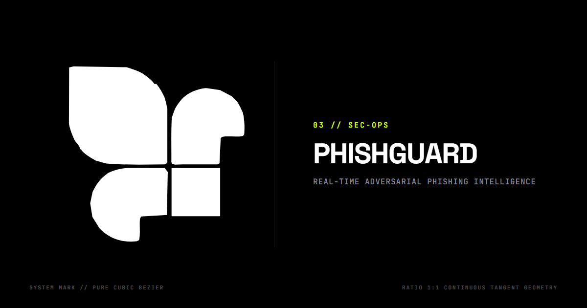

<div align="center">



<br/><br/>


# PhishGuard: Real-Time Adversarial Phishing Intelligence

An end-to-end browser defense architecture coupling a client-side Manifest V3 Chrome extension with an asynchronous FastAPI threat-scoring engine to intercept zero-day credential harvesting and homoglyph domain attacks.

[Architecture](#architecture) | [Detection Methodology](#detection-methodology) | [Browser Extension Setup](#browser-extension-setup) | [Backend Setup](#backend-setup) | [API Reference](#api-reference) | [Test Suite](#test-suite) | [Attribution](#engineering-attribution)

</div>

---

## Technical Overview

Modern phishing infrastructure relies on rapid domain cycling, mixed-script homoglyph substitution, and short-lived hosts that easily bypass traditional static blacklists. Because DNS and reputation databases suffer from a multi-hour lag window, PhishGuard evaluates threats deterministically at request time directly within the client browser.

The platform operates across two synchronized tiers:
1. **Client Tier (Manifest V3 Extension):** Intercepts navigation events, monitors DOM hyperlink structures, and communicates asynchronously with the local inspection daemon without stalling render threads.
2. **Analysis Tier (FastAPI Daemon):** Processes candidate URLs against multi-factor heuristic evaluators, computing lexical risk factors, character entropy, and homoglyph code-points in sub-10ms latency.

---

## Architecture

```
[ Web Browser ]
      |
      +---> content.js (DOM Anchor Analysis & Warning Overlay)
      |
      +---> background.js (Asynchronous Service Worker Gateway)
      |         |
      |         | (HTTP POST /scan, non-blocking)
      |         v
[ FastAPI Threat Inspection Daemon ]
      |
      +---> Shannon Entropy Engine (Calculates character distribution randomness)
      +---> Punycode & Mixed-Script Detector (Flags non-ASCII unicode code-points)
      +---> Lexical Anomaly Analyzer (Extracts IP hosts, keyword density, path depth)
      +---> Target Brand Heuristic (Flags unauthorized auth/banking impersonation)
      |
      +---> Multi-Factor Risk Synthesizer
                |
                v
         [ Verdict: SAFE | SUSPICIOUS | MALICIOUS ]
```

---

## Detection Methodology

### 1. Unicode Homoglyph & Punycode Identification
Attackers frequently exploit visually indistinguishable characters from foreign scripts (such as substituting Latin 'a' with Cyrillic 'а' / U+0430). The homoglyph engine extracts the normalized domain name, identifies the presence of internationalized domain name (IDN) prefixes (`xn--`), and parses raw character byte values:

$$\text{is\_spoofed}(D) = (D \text{ contains } \text{"xn--"}) \lor \exists c \in D : \text{ord}(c) > 127$$

### 2. Shannon Entropy for DGA Detection
Algorithmic Domain Generation (DGA) generates high-entropy hostnames designed to evade domain reputation filters. PhishGuard evaluates character-level entropy:

$$H(X) = -\sum_{i=1}^{n} P(x_i) \log_2 P(x_i)$$

Hostnames exceeding an entropy threshold ($H > 4.2$) are flagged for algorithmic randomness.

### 3. Lexical and Structural Indicators
The lexical parser assesses ten structural risk dimensions, including:
- Numeric IPv4 addresses utilized as hostnames in place of registered domain names.
- Subdomain chaining greater than three levels.
- Authentication keyword clustering (`login`, `signin`, `verify`, `banking`, `wallet`).
- Unauthorized financial and tech brand impersonation.

---

## Browser Extension Setup

### Prerequisites
- Google Chrome, Chromium, or Microsoft Edge.
- Python 3.10+ (for backend engine).

### Installation Steps
1. Clone this repository locally:
   ```bash
   git clone https://github.com/harctik/PhishGuard.git
   cd PhishGuard
   ```
2. Open Google Chrome and enter `chrome://extensions/` in the address bar.
3. Toggle the **Developer mode** switch in the top right corner.
4. Click **Load unpacked** and select the `PhishGuard/extension` folder.
5. The PhishGuard shield will appear in your browser toolbar.

---

## Backend Setup

1. Create and activate a Python virtual environment:
   ```bash
   python -m venv venv
   # Windows:
   venv\Scripts\activate
   # Linux/macOS:
   source venv/bin/activate
   ```
2. Install required dependencies:
   ```bash
   pip install -r requirements.txt
   ```
3. Start the FastAPI daemon:
   ```bash
   uvicorn backend.main:app --reload --port 8000
   ```
4. Confirm service status by accessing `http://localhost:8000/health`.

---

## API Reference

### POST /scan
Analyzes a URL and returns a detailed risk assessment.

**Request:**
```json
{
  "url": "http://192.168.1.100/paypal-verification/secure/login"
}
```

**Response:**
```json
{
  "url": "http://192.168.1.100/paypal-verification/secure/login",
  "hostname": "192.168.1.100",
  "risk_score": 95,
  "verdict": "MALICIOUS",
  "entropy": 2.784,
  "reasons": [
    "Raw IP address used instead of legitimate registered domain",
    "Targeted brand spoofing detected: paypal",
    "Multiple credential-harvesting keywords found: verification, secure, login",
    "Unencrypted HTTP transmission"
  ]
}
```

---

## Test Suite

Automated unit tests validate entropy calculations, homoglyph detection, and API responses:

```bash
pytest tests/ -v
```

All test cases are integrated into GitHub Actions CI (`.github/workflows/ci.yml`) to ensure regression stability across Python 3.10 and 3.11.

---

## Engineering Attribution

All architecture, software engineering, heuristics design, and testing in this repository were engineered end-to-end by **Avvari Naga Harthikanand (Harthik)**.

- **Developer:** Avvari Naga Harthikanand
- **LinkedIn:** https://www.linkedin.com/in/harthik
- **GitHub:** https://github.com/harctik
- **Email:** harthikanand90@gmail.com
- **License:** MIT License
