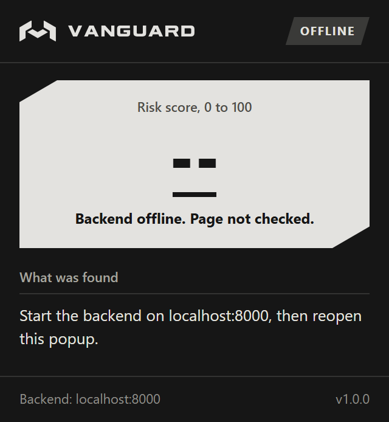

# Vanguard


Vanguard is a Manifest V3 Chrome extension with a small FastAPI service behind it. The service scores a web address against nine fixed rules and returns a score, a verdict and the rules that matched. It runs on your own machine.

The repository is still named `PhishGuard`, the project's earlier name.

A static project page is in [docs/index.html](docs/index.html). Open it from a clone of the repository.

## What it does

1. After a page loads, `content.js` sends that page's address to the service worker, which posts it to `http://localhost:8000/scan`.
2. If the verdict is `MALICIOUS`, a dismissible warning bar appears at the top of the page.
3. The toolbar popup scans the active tab each time you open it and shows the score and the matched rules.

It looks only at the address. It does not read page content or links, block navigation, cache results or use a blocklist.

## The popup

| High risk | No rule matched | Service not running |
|---|---|---|
|  |  |  |

These are headless Chrome renders of the shipped popup files. The `chrome.tabs` lookup was stubbed to supply a sample address, and the scores came from a locally running backend.

## Scoring rules

Points add up and are capped at 100. Source: [backend/detector.py](backend/detector.py).

| Rule | Matches when | Points |
|---|---|---|
| Lookalike characters | The hostname has a punycode label (`xn--`) or any non-ASCII character | 45 |
| Brand name | The hostname contains paypal, apple, google, microsoft, amazon, netflix, chase, wellsfargo, bankofamerica, binance or coinbase, and does not end with `<brand>.com` | 40 |
| IP address | The host is a bare IPv4 address | 35 |
| At sign | `@` appears anywhere in the address | 30 |
| Risky ending | The hostname ends in `.xyz` `.top` `.buzz` `.club` `.work` `.cfd` `.sbs` or `.cam` | 20 |
| Sign-in words | The path or query contains at least two of: login, signin, verify, secure, update, banking, account, password, credential, auth, wallet, recover | 20 |
| Random-looking host | Shannon entropy of the hostname is above 4.2 | 20 |
| Deep subdomains | Three or more labels sit in front of the last two | 15 |
| No HTTPS | The scheme is not `https` (an address without a scheme is treated as `http`) | 10 |

| Score | Verdict |
|---|---|
| 0 to 24 | `SAFE` |
| 25 to 59 | `SUSPICIOUS` |
| 60 to 100 | `MALICIOUS` |

`SAFE` means few or no rules matched. It does not mean the site is trustworthy.

## Known limits

- A phishing page on an ordinary-looking or hijacked domain scores low.
- The brand check has no dot boundary: `evilpaypal.com` is not flagged, while `google.co.uk` is.
- Every internationalised domain gets the lookalike points, including legitimate ones.
- IPv6 hosts are not matched by the IP rule.
- If the service is unreachable, the service worker answers `SAFE` and no warning bar appears. The popup says the page was not checked.
- Every page address, including its query string, is sent to port 8000 over plain HTTP.
- The API allows cross-origin requests from any website. Keep it bound to localhost and stop it when you are not using it.
- A malformed address such as `http://[abc` makes `/scan` return a 500.

## Setup

```bash
git clone https://github.com/harctik/PhishGuard.git
cd PhishGuard
python -m venv venv

# Windows:
venv\Scripts\activate
# Linux/macOS:
source venv/bin/activate

pip install -r requirements.txt
uvicorn backend.main:app --port 8000
```

Then load the extension:

1. Open `chrome://extensions/`.
2. Turn on Developer mode.
3. Choose Load unpacked and select the `PhishGuard/extension` folder.

### Tests

```bash
pytest tests/ -v
```

## API

| Route | Purpose |
|---|---|
| `GET /` | Service name and version |
| `GET /health` | Health check |
| `POST /scan` | Score one address: `{"url": "..."}`. An empty address returns 400. |
| `POST /scan/bulk` | Score up to 100 addresses: `{"urls": ["..."]}` |

Response from `POST /scan` for `http://xn--pypal-4ve.com/login/verify.php`:

```json
{
  "url": "http://xn--pypal-4ve.com/login/verify.php",
  "hostname": "xn--pypal-4ve.com",
  "risk_score": 75,
  "verdict": "MALICIOUS",
  "entropy": 3.6901,
  "reasons": [
    "Punycode or non-ASCII homoglyph character spoofing detected",
    "Multiple credential-harvesting keywords found: login, verify",
    "Unencrypted HTTP transmission"
  ],
  "features": {
    "hostname": "xn--pypal-4ve.com",
    "url_length": 41,
    "is_ip_host": false,
    "subdomain_count": 0,
    "keywords_found": [
      "login",
      "verify"
    ],
    "brand_mentions": [],
    "has_risky_tld": false,
    "uses_https": false,
    "has_at_symbol": false
  },
  "homoglyph_analysis": {
    "is_punycode": true,
    "has_mixed_script": false,
    "non_ascii_count": 0,
    "spoofed": true
  }
}
```

## Layout

```text
PhishGuard/
├── backend/
│   ├── main.py              # FastAPI routes
│   └── detector.py          # Scoring rules
├── extension/
│   ├── manifest.json        # Manifest V3 configuration
│   ├── background.js        # Service worker that calls the backend
│   ├── content.js           # Sends the page address, draws the warning bar
│   ├── icons/
│   └── popup/               # Toolbar popup
├── docs/                    # Project page, brand assets, popup renders
├── tests/
│   └── test_vanguard.py
├── pyproject.toml
└── requirements.txt
```

---

## Author and Engineering Attribution

All architecture, heuristic formulations, backend API development, and Chrome Extension Manifest V3 implementation in this repository were engineered end-to-end by Avvari Naga Harthikanand (Harthik).

Developer: Avvari Naga Harthikanand
Location: Bangalore, Karnataka, India
LinkedIn: https://www.linkedin.com/in/harthik
GitHub: https://github.com/harctik
Email: harthikanand90@gmail.com
License: MIT License
